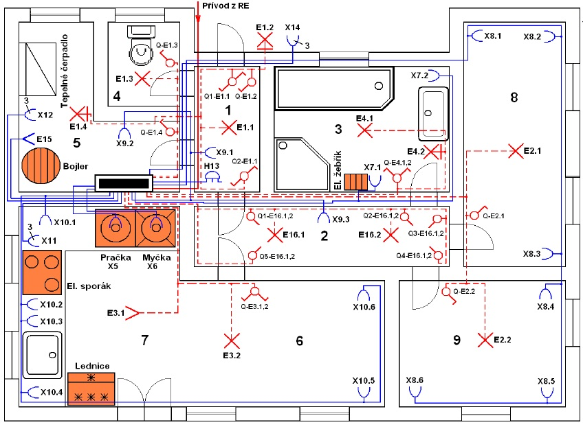

[Co dodělat ]: #

## Úlohy k PLC

---
>U klasifikovaných úloh nejde jen o jejich mechanické vypracování, ale především o **porozumění logice programu, správné elektrotechnické zapojení, diagnostiku chyb a správné používání odborných pojmů**.
> U úloh můžete vypracovat bonusové otázky označené :star2: a ověřit si pokročilé inženýrské souvislosti. Případně **můžete program přepsat do jiného jazyka, zadání rozšířit a poupravit**. Nezapomeňte si pak říct o odměnu.
---

### 3. Seznámení se simulátorem Mosaic a základní logické funkce v jazyce ST (průvodce)

*Časová dotace: 45 minut | :bangbang: Klasifikovaná úloha ve stylu průvodce s postupným doplňováním kódu*

> **Použitý HW / SW:** Vývojové prostředí **Teco Mosaic**, simulátor PLC, centrální jednotka **Foxtrot CP-2091**, norma ČSN EN 61131-3 (jazyk Strukturovaný text – ST).
> **Průmyslová paralela:** V automatizaci procesů i budov tvoří základ řízení logické vazby: blokování chodu pohonu při nesplnění podmínek (funkce AND), havarijní stop (funkce NOR) nebo střídavé přepínání světel ze dvou míst (funkce XOR).

**Cíl úlohy:** Založit projekt v prostředí Mosaic pro CP-2091, otestovat překlad a nahrání prázdného projektu do simulátoru a naprogramovat v jazyce ST ověření základních kombinačních funkcí AND, NOR a XOR pro dvě vstupní proměnné.

#### Krok 1 – Založení projektu a spuštění simulátoru (4 min)
1. Spusťte vývojové prostředí **Mosaic** $\rightarrow$ zvolte **Projekt $\rightarrow$ Nová skupina projektů**.
2. **Výběr konfiguračního nástroje** -> **I/O Configurátor pro řady...**
3. **Nový projekt**
4. **Deklarace programové organizační jednotky** -> **ST**
5. **Deklarace instance programu**
6. Okno **I/O Configurátoru** -> **Založit novou konfiguraci** -> Jako centrální jednotku vyberte **Foxtrot 2 CP-2091**
7. V prostředí **Mosaic** zapněte připojení k **simulovanému PLC**.
	- Otevřete **Manažer projektu** (ikonka složky s lupou vlevo nahoře)
	- Položka **Typ připojení**
	- Vyberte **Simulovaný PLC** a pak připojit.
8. V editoru byste měli mít otevřený hlavní program **prgMain**.
9. Nechte program prázdný, případně použijte jen základní strukturu programu podle vašeho postupu.
10. Stiskněte **Přeložit** (**F9**)
11. Poté zvolte **Run** (**Ctrl+F9**)
12. Do protokolu zapište stav simulátoru:
   - Proběhl překlad bez chyb (0 Errors, 0 Warnings)? 
	`[ ] Ano`
	`[ ] Ne`
   - Běží simulátor v režimu RUN? 
	`[ ] Ano`
	`[ ] Ne`

> ⚠️ **Častá chyba začátečníků:** Začít psát složitý kód před ověřením funkčnosti základní konfigurace simulátoru. Pokud simulátor hlásí chybu licence nebo chybějící HW profil, je nutné nejprve opravit nastavení projektu. => Snažte se každý krok rozdělit na menší, které se dají otestovat, budou se vám snáze hledat a řešit problémy.

#### Krok 2 – Doplňovačka: Logické funkce v jazyce ST dle ČSN EN 61131-3 (6 min)
Doplňte chybějící logické operátory a přiřazení v programu `prgLogicTest`:

```pascal
PROGRAM prgMain
VAR
    DI_A : BOOL;  (* Vstupní proměnná A *)
    DI_B : BOOL;  (* Vstupní proměnná B *)

    DO_AND : BOOL; (* Výstup logické funkce AND *)
    DO_NOR : BOOL; (* Výstup logické funkce NOR *)
    DO_XOR : BOOL; (* Výstup logické funkce XOR *)
END_VAR

// 1. Funkce AND: Výstup je TRUE, pokud jsou oba vstupy TRUE
DO_AND := DI_A ??? DI_B;                    // 💡 DOPLŇTE: operátor AND

// 2. Funkce NOR: Výstup je TRUE, pokud ani jeden ze vstupů NENÍ TRUE (negace OR)
DO_NOR := ??? (DI_A OR DI_B);               // 💡 DOPLŇTE: operátor NOT

// 3. Funkce XOR: Výstup je TRUE, pokud se hodnoty vstupů liší (alternativa pro schodišťové ovládání)
DO_XOR := DI_A ??? DI_B;                    // 💡 DOPLŇTE: operátor XOR
END_PROGRAM
```

*Vaše doplnění:*
- Operátor pro logický součin: `DO_AND := DI_A` `...` `DI_B;`
- Operátor pro negaci součtu: `DO_NOR :=` `...` `(DI_A OR DI_B);`
- Operátor pro nonekvivalenci: `DO_XOR := DI_A` `...` `DI_B;`

<details>
<summary> :bulb: Nápověda v jazyce C / Python: </summary>
<p>V jazyce C odpovídá AND operátoru <code>&&</code>, NOR je <code>!(A || B)</code> a XOR je <code>A ^ B</code>. V normě ČSN EN 61131-3 ST se používají přímo vyhrazená klíčová slova <code>AND</code>, <code>OR</code>, <code>XOR</code> a unární negace <code>NOT</code>.</p>
</details>

#### Krok 3 – Odzkoušení na reálném HW (30 min)

Zapojte PLC spolu s dalším potřebným HW. 
Před připojením 230 V ke zdroji zkontrolujte, zda máte správně zapojeno napájení. 
**Zapojení si nechte zkontrolovat.** 
Mezi tím upravte případně program tak, aby vnitřní proměnné byly nahrazeny tlačítky a kontrolkami na DI a DO.
Poté PLC zapněte, připojte PC, nahrajte a odzkoušejte program.

#### Krok 4 – Vzájemné testování (Peer testing protokol) (5 min)
Student A prověří program Studenta B v okně sledování proměnných simulátoru Mosaic pomocí ručního vnucení hodnot (Force value):

1. Projekt **přeložte** a **nahrajte do simulátoru**.
2. Připojte se na **simulované PLC** a ověřte, že simulátor běží v režimu **RUN**.
3. V ladicích nástrojích sledujte stavy vstupů a nastavujte hodnoty výstupů:
	- Pro test vstupů a výstupů je možné použít i **fixaci** (zámeček u hodnoty vstupu/výstupu) v **I/O Configuratoru** přes ikonu zámku.
	- Pro sledování jakýchkoliv námi vybraných proměnných použijte **Zobrazit** -> **Data** (Ctrl+Alt+W). Okno se zobrazí v dolní liště. Proměnné přidáte pomocí tlačítka **Přidat položku** (ikonka s brýlemi/klávesa Ins). Proměnné z příkladu naleznete v záložce **Instance**. Pokud vám nepůjde měnit hodnoty, zkontrolujte, zda je tato možnost povolena (ikona květiny vedle nápisu Run).
	- Další nástroje jsou např. **Break Point**, **GraphMaker**...

<details>
<summary> :bulb: Nápověda pomocí Teco Wiki a Teco AI: </summary>
<a href="https://wiki.tecomat.cz/">Teco Wiki</a><br>
<a href="https://ai.tecomat.cz/">Teco AI</a>
</details>

| Test | Vstup `DI_A` | Vstup `DI_B` | Očekávaný `DO_AND` | Očekávaný `DO_NOR` | Očekávaný `DO_XOR` | Skutečně odečteno | Hodnocení testera |
| :--- | :--- | :--- | :--- | :--- | :--- | :--- | :--- |
| **T3.1** | `FALSE` (0) | `FALSE` (0) | `0` | `1` | `0` | `...` | `[ ] OK` / `[ ] KO` |
| **T3.2** | `TRUE` (1) | `FALSE` (0) | `0` | `0` | `1` | `...` | `[ ] OK` / `[ ] KO` |
| **T3.3** | `FALSE` (0) | `TRUE` (1) | `0` | `0` | `1` | `...` | `[ ] OK` / `[ ] KO` |
| **T3.4** | `TRUE` (1) | `TRUE` (1) | `1` | `0` | `0` | `...` | `[ ] OK` / `[ ] KO` |

> :key: **Vysvětlení pojmů a odborné zdroje:**
> - **Cyklické vykonávání programu v PLC:** PLC cyklus sestává ze čtení fyzických vstupů do procesního obrazu vstupů (PII), vykonání uživatelského programu a zápisu procesního obrazu výstupů (PIQ) na fyzické svorky.
>   
	Obr. převzatý z: TECO A.S. *PROGRAMOVATELNÉ AUTOMATY TECOMAT FOXTROT 2*. Kolín: Teco a.s., 2026. Dostupné také z: https://wiki.tecomat.cz/
> - **Booleova algebra v automatizaci:** Základní matematický aparát číslicového řízení definující pravdivostní tabulky logických členů.
>   Booleova algebra. In: *Wikipedie: Otevřená encyklopedie* [online]. San Francisco (CA): Wikimedia Foundation, 2024 [cit. 2026-10-27]. Dostupné z: https://cs.wikipedia.org/wiki/Booleova_algebra

:star2: **Bonusová otázka k úloze 3:**
Jak lze funkci XOR realizovat pouze za použití základních logických hradel AND, OR a NOT? Zapište příslušný logický výraz v jazyce ST.

*Vaše odpověď:*
`...`

---

### 4. Bistabilní paměť a schodišťové ovládání osvětlení ze dvou míst v jazyce ST (průvodce)

*Časová dotace: 45 minut | :bangbang: Klasifikovaná úloha ve stylu průvodce s postupným doplňováním kódu*

> **Kontext z praxe:** V moderní automatizaci budov se již nepoužívají klasické střídavé přepínače (řazení 6 a 7) s velkým množstvím kabelů. Na zdi jsou instalována tlačítka posílající krátký impuls. Změna stavu svítidla se provádí paměťovou bistabilní funkcí (impulzní relé / toggle).
> **Průmyslová paralela:** Tlačítkové ovládání spuštění/zastavení dopravníkového pásu jedním ovladačem nebo přepínání pracovních režimů stroje.

**Cíl úlohy:** Vytvořit v jazyce ST program pro ovládání osvětlení ze dvou nezávislých tlačítek (`DI_Btn1`, `DI_Btn2`). Stisk libovolného tlačítka musí změnit stav svítidla (rozsvítit/zhasnout). Úloha řeší správné ošetření náběžné hrany signálu pomocí funkčního bloku `R_TRIG`.

#### Krok 1 – Princip detekce náběžné hrany (4 min)
Proč nelze v PLC programu použít přímou podmínku `IF (DI_Btn1 OR DI_Btn2) THEN DO_Light := NOT DO_Light; END_IF;` bez detekce hrany?
Co by se stalo během stisku tlačítka trvajícího 300 ms, pokud jeden cyklus PLC trvá 2 ms?

*Vaše vysvětlení:*
`...`

#### Krok 2 – Doplňovačka: Impulzní relé s `R_TRIG` v jazyce ST (6 min)
Doplňte funkční blok detekce náběžné hrany a bistabilní přepnutí:

```pascal
PROGRAM prgToggleLight
VAR
    DI_Btn1 : BOOL; (* Tlačítko 1 u dveří *)
    DI_Btn2 : BOOL; (* Tlačítko 2 u postele *)
    DO_Light : BOOL := FALSE; (* Svítidlo v pokoji *)

    fbEdge1 : ???;            (* 💡 DOPLŇTE: Standardní funkční blok náběžné hrany dle IEC 61131-3 *)
    fbEdge2 : ???;            (* 💡 DOPLŇTE: Standardní funkční blok náběžné hrany dle IEC 61131-3 *)
    bAnyPressed : BOOL;
END_VAR

// 1. Detekce náběžné hrany pro obě tlačítka:
fbEdge1(CLK := DI_Btn1);
fbEdge2(CLK := DI_Btn2);

// 2. Vyhodnocení, zda došlo ke stisku kteréhokoliv tlačítka:
bAnyPressed := fbEdge1.??? OR fbEdge2.???;  // 💡 DOPLŇTE: výstupní proměnná funkčního bloku (Q)

// 3. Změna stavu svítidla (toggle):
IF bAnyPressed THEN
    DO_Light := ??? DO_Light;               // 💡 DOPLŇTE: operátor negace aktuálního stavu
END_IF;
END_PROGRAM
```

*Vaše doplnění:*
- Typ funkčního bloku hrany: `fbEdge1 :` `...`
- Výstupní příznak zachycené hrany: `fbEdge1.` `...`
- Operátor přepnutí stavu: `DO_Light :=` `...` `DO_Light;`

<details>
<summary> :bulb: Nápověda k odzkoušení programu: </summary>
<p><code>R_TRIG</code> generuje impuls jen při přechodu <code>0 → 1</code> a používá vstup <code>CLK</code> a výstup <code>Q</code>. V programu je ale <code>DO_Light</code> jen lokální proměnná, takže se její změna nikam nepromítne.</p>
<p>To znamená, že v simulátoru můžete vidět změnu pouze tehdy, pokud:</p>
<ol>
   <li>sledujete přímo <code>DO_Light</code> jako interní proměnnou, nebo</li>
   <li>přiřadíte <code>DO_Light</code> na skutečný výstupní signál, např. <code>r16_p6_IO_OUT.DOS.DO0 := DO_Light;</code></li>
</ol>
</details>

#### Krok 3 – Odzkoušení na reálném HW (30 min)

Zapojte PLC spolu s dalším potřebným HW. 
Před připojením 230 V ke zdroji zkontrolujte, zda máte správně zapojeno napájení. 
**Zapojení si nechte zkontrolovat.** 
Mezi tím upravte případně program tak, aby vnitřní proměnné byly nahrazeny tlačítky a kontrolkami na DI a DO.
Poté PLC zapněte, připojte PC, nahrajte a odzkoušejte program.

#### Krok 4 – Vzájemné testování (Peer testing protokol) (5 min)
Tester ověří reakci programu na dlouhý stisk i rychlé střídání tlačítek v simulátoru Mosaic:

| Test | Akce testera v simulátoru | Očekávaný stav svítidla `DO_Light` | Skutečně odečtený stav | Výsledek |
| :--- | :--- | :--- | :--- | :--- |
| **T4.1** | Klidový stav (žádné tlačítko nestisknuto) | `FALSE` (zhasnuto) | `...` | `[ ] OK` / `[ ] KO` |
| **T4.2** | Krátký stisk tlačítka 1 (`DI_Btn1` := 1 a zpět 0) | `TRUE` (rozsvítí se) | `...` | `[ ] OK` / `[ ] KO` |
| **T4.3** | Trvalé držení tlačítka 1 (`DI_Btn1` := 1 po dobu 5 s) | Zůstává trvale `TRUE` (nesmí kmitat!) | `...` | `[ ] OK` / `[ ] KO` |
| **T4.4** | Stisk tlačítka 2 (`DI_Btn2` := 1 a zpět 0) | `FALSE` (zhasne) | `...` | `[ ] OK` / `[ ] KO` |

> ⚠️ **Častá chyba v zapojení a programu:** Záměna funkčního bloku `R_TRIG` za prostý dotaz na proměnnou. Pokud je vynechána detekce hrany, svítidlo začne při stisku tlačítka měnit stav v každém cyklu PLC (stovky sepnutí za sekundu), což vede k náhodnému výslednému stavu po uvolnění tlačítka.

> :key: **Vysvětlení pojmů a odborné zdroje:**
> - **Funkční blok R_TRIG dle ČSN EN 61131-3:** Standardní funkční blok pro detekci přechodu z log. 0 do log. 1. Výstup `Q` nabývá hodnoty `TRUE` přesně po dobu jednoho programového cyklu PLC bezprostředně po náběhu vstupního signálu `CLK`.
>   ČESKÝ NORMALIZAČNÍ INSTITUT. *ČSN EN 61131-3 ed. 3: Programovatelné řídicí jednotky – Část 3: Programovací jazyky*. Praha: ÚNMZ, 2014.
> - **Impulzní relé (bipolární spínač):** Elektromechanický nebo elektronický prvek umožňující ovládat jeden obvod z neomezeného počtu paralelně řazených tlačítek.

:star2: **Bonusová otázka k úloze 4:**
Jak byste v jazyce ST realizovali funkci tzv. centrálního vypnutí („odchodové tlačítko"), které při odchodu z bytu jedním stiskem bezpodmínečně zhasne všechna světla bez ohledu na jejich aktuální stav?

*Vaše odpověď:*
`...`

---

### 5. Časově zpožděné vypnutí ventilátoru a schodišťového osvětlení (průvodce)

*Časová dotace: 50–55 minut | :bangbang: Klasifikovaná úloha ve stylu průvodce*

> **Kontext z praxe:** V hygienických zázemích (WC, koupelny) a na schodištích je klíčovou funkcí automatizace budov zpožděné vypnutí zátěže (dosvit schodiště, doběh odtahového ventilátoru pro odvod vlhkosti po opuštění místnosti).
> **Průmyslová paralela:** Chlazení vřetene CNC obráběcího centra po ukončení frézování nebo doběh mazacího čerpadla převodovky po zastavení linky.

**Cíl úlohy:** Sestavit v jazyce ST program pro spínání světla a zpožděné vypnutí odtahového ventilátoru. Rozsvícení světla tlačítkem okamžitě sepne ventilátor. Po zhasnutí světla musí ventilátor pokračovat v běhu po nastavenou dobu doběhu $t_{delay} = 15\text{ s}$ pomocí funkčního bloku `TOF`.

#### Krok 1 – Časový diagram a návrh stavů (5 min)
Prohlédněte si průběh signálů a doplňte logické hodnoty do stavové tabulky:

```
Tlačítko (DI_Btn):    __|-|__________|-|___________________
Světlo (DO_Light):    __|------------|_____________________
Ventilátor (DO_Fan):  __|---------------------------|______
                                     <-- t_delay -->
```

| Fáze procesu | Stav vstupu `DI_Btn` | Stav světla `DO_Light` | Stav ventilátoru `DO_Fan` | Stav časovače `TOF.Q` |
| :--- | :--- | :--- | :--- | :--- |
| **Klidový stav** | `0` (rozepnuto) | `0` (nesvítí) | `0` (stojí) | `0` |
| **Uživatel rozsvítil** | `0` (po stisku) | `1` (svítí) | `...` | `...` |
| **Uživatel zhasnul** | `0` (po stisku) | `0` (zhasnuto) | `...` (dobíhá) | `...` (odpočítává) |
| **Uplynul čas doběhu** | `0` (rozepnuto) | `0` (zhasnuto) | `0` (zastaven) | `0` |

#### Krok 2 – Implementace v jazyce ST s blokem TOF (12 min)
Doplňte chybějící deklarace a časové parametry:

```pascal
PROGRAM prgBathFanControl
VAR
    DI_BtnToggle : BOOL; (* Tlačítko osvětlení *)
    DO_Light : BOOL := FALSE; (* Světlo na WC *)
    DO_Fan : BOOL := FALSE; (* Odtahový ventilátor *)

    fbBtnEdge : R_TRIG;
    fbFanTimer : ???;          (* 💡 DOPLŇTE: Standardní funkční blok časovače zpožděného odpadu *)
    tFanDelay : TIME := T#15s; (* Doba doběhu ventilátoru 15 sekund *)
END_VAR

// 1. Obsluha tlačítka osvětlení (bistabilní spínač):
fbBtnEdge(CLK := DI_BtnToggle);
IF fbBtnEdge.Q THEN
    DO_Light := NOT DO_Light;
END_IF;

// 2. Časovač zpožděného odpadu pro ventilátor:
// Vstupem IN je přímo stav osvětlení DO_Light
fbFanTimer(
    IN := ???,                 // 💡 DOPLŇTE: řídicí proměnná pro časovač
    PT := ???                  // 💡 DOPLŇTE: předvolba doby doběhu
);

// 3. Přiřazení výstupu časovače na fyzický výstup ventilátoru:
DO_Fan := fbFanTimer.???;      // 💡 DOPLŇTE: výstupní proměnná časovače (Q)
END_PROGRAM
```

*Vaše doplnění:*
- Typ funkčního bloku časovače: `fbFanTimer :` `...`
- Vstupní signál časovače: `IN :=` `...`
- Předvolba času: `PT :=` `...`
- Výstupní logická hodnota: `fbFanTimer.` `...`

<details>
<summary> :bulb: Nápověda – Rozdíl mezi bloky TON a TOF: </summary>
<p>Funkční blok <code>TON</code> (Timer On Delay) generuje výstupní log. 1 až po uplynutí doby od náběhu vstupu (zpožděné zapnutí). Funkční blok <code>TOF</code> (Timer Off Delay) generuje výstupní log. 1 okamžitě při sepnutí vstupu a drží jej sepnutý ještě po nastavenou dobu <code>PT</code> po odpadnutí vstupního signálu (zpožděné vypnutí / doběh).</p>
</details>

#### Krok 3 – Odzkoušení na reálném HW (30 min)

Zapojte PLC spolu s dalším potřebným HW. 
Před připojením 230 V ke zdroji zkontrolujte, zda máte správně zapojeno napájení. 
**Zapojení si nechte zkontrolovat.** 
Mezi tím upravte případně program tak, aby vnitřní proměnné byly nahrazeny tlačítky a kontrolkami na DI a DO.
Poté PLC zapněte, připojte PC, nahrajte a odzkoušejte program.

#### Krok 4 – Protokol vzájemné oponentury (Peer testing) (5 min)
Tester prověří chování v simulátoru Mosaic:

| Číslo testu | Akce testera                           | Očekávaná odezva PLC                                  | Skutečnost odečtená testerem | Splněno (OK / KO)   |
| :---------- | :------------------------------------- | :---------------------------------------------------- | :--------------------------- | :------------------ |
| **T5.1**    | Krátký stisk tlačítka (rozsvícení)     | `DO_Light = 1`, `DO_Fan = 1` okamžitě                 | `...`                        | `[ ] OK` / `[ ] KO` |
| **T5.2**    | Druhý stisk tlačítka (zhasnutí)        | `DO_Light = 0`, ale `DO_Fan` zůstává `1`              | `...`                        | `[ ] OK` / `[ ] KO` |
| **T5.3**    | Měření času doběhu                     | `DO_Fan` odpadne do `0` přesně po 15 sekundách        | `...` s                      | `[ ] OK` / `[ ] KO` |
| **T5.4**    | Znovurozsvícení během 10. sekundy běhu | Časovač se přeruší, ventilátor běží bez přerušení dál | `...`                        | `[ ] OK` / `[ ] KO` |

> ⚠️ **Častá chyba v PLC programech:** Použití časovače `TON` namísto `TOF`. Pokud by byl použit blok `TON`, ventilátor by se rozběhl až po 15 sekundách nepřetržitého svícení, což je v rozporu se zadáním rychlého odtahu.

> :key: **Vysvětlení pojmů a odborné zdroje:**
> - **Funkční blok TOF (ČSN EN 61131-3):** Časovač zpožděného odpadu. Výstup `Q` přechází do stavu `TRUE` okamžitě při náběhu vstupu `IN` a přechází do stavu `FALSE` až po uplynutí času `PT` od sestupné hrany vstupu `IN`.
>   ČESKÝ NORMALIZAČNÍ INSTITUT. *ČSN EN 61131-3 ed. 3: Programovatelné řídicí jednotky – Část 3: Programovací jazyky*. Praha: ÚNMZ, 2014.
> - **Norma ČSN EN 15251:** Vstupní parametry vnitřního prostředí pro návrh a posuzování energetické náročnosti budov s ohledem na kvalitu vnitřního vzduchu a větrání.

:star2: **Bonusová otázka k úloze 5:**
Jak byste logiku upravili, pokud by se ventilátor neměl sepnout při každém krátkém vstupu na toaletu (např. pouhé umytí rukou do 60 sekund), ale sepnul se až po 1 minutě trvalého svícení světla s následným doběhem 5 minut po zhasnutí? Které dva funkční bloky byste zkombinovali?

*Vaše odpověď:*
`...`

---

### 6. Pokročilé sekvenční řízení: Dopravníkový podavač a třídicí stanice se senzory (průvodce)

*Časová dotace: 50–60 minut | :star2: Bonusová výzva pro pokročilé studenty ve stylu průvodce*

> **Kontext automatizace:** Ve výrobních linkách i moderních skladech se manipulace s materiálem řídí sekvencí časových a senzorických událostí. Optické a indukční senzory indikují přítomnost dílu, časovače definují dobu posuvu a pneumatické válce třídí výrobky.
> **Vybavení ze soupisu HW:** PLC Foxtrot CP-2091, modul C-IR-0303M, optický a indukční senzor PNP/NPN, kontrolky OEZ na DIN lištu.

**Cíl úlohy:** Sestavit program v jazyce ST modelující automatickou třídicí linku se třemi stavy procesu s využitím časovačů `TON` a čítače kusů `CTU`.

#### Popis technologického cyklu linky:
1. **Klidový stav (`STATE_IDLE`):** Linka čeká na stisk tlačítka START (`DI_Start`).
2. **Přísun a detekce dílu (`STATE_FEED`):** Sepne se motor dopravníku (`DO_Conveyor`). Jakmile optický senzor (`DI_OptoSensor`) detekuje čelo dílu, dopravník běží ještě $t_{posuv} = 3\text{ s}$, aby díl dojel pod inspekční kameru.
3. **Kontrola kovu a třídění (`STATE_INSPECT`):** Dopravník stojí. Probíhá vyhodnocení indukčním snímačem (`DI_InductiveSensor`):
   - Pokud je díl kovový, vysune se třídicí píst (`DO_Ejector`) na dobu $2\text{ s}$ a inkrementuje se čítač kovových dílů.
   - Pokud díl není kovový, propadne bez vyražení do standardního zásobníku.
4. Po dokončení inspekce se systém automaticky vrací do stavu `STATE_FEED` pro další kus. Tlačítko STOP (`DI_Stop`) okamžitě přeruší cyklus.

#### Krok 1 – Návrh stavového automatu (FSM) a I/O tabulky (5 min)
Doplňte do rozhodovací tabulky stavů akční členy a podmínky přechodu:

| Název stavu | Motor `DO_Conveyor` | Píst `DO_Ejector` | Signalizace `DO_Alarm` | Podmínka přechodu do dalšího stavu |
| :--- | :--- | :--- | :--- | :--- |
| `ST_IDLE` | `0` (stojí) | `0` (zasunut) | `0` | Stisk tlačítka START (`DI_Start = 1`) |
| `ST_FEED` | `1` (běží) | `0` | `0` | Optický senzor sepnut a vypršel časovač 3 s |
| `ST_INSPECT` | `0` (stojí) | `...` | `...` | Uplynutí doby inspekce 2 s $\rightarrow$ návrat do `ST_FEED` |
| `ST_FAULT` | `0` (stojí) | `0` | `1` (bliká) | Porucha / stisk STOP tlačítka |

#### Krok 2 – Implementace stavového automatu v jazyce ST (15 min)
Doplňte chybějící části řídicího kódu a zjistěte, zda program skutečně pracuje, jak má:

```pascal
TYPE E_LineState : (ST_IDLE, ST_FEED, ST_INSPECT, ST_FAULT);
END_TYPE

PROGRAM prgSortingLine
VAR
    DI_Start : BOOL;
    DI_Stop : BOOL;
    DI_OptoSensor : BOOL; // Optický snímač dílu
    DI_InductiveSensor : BOOL; // Indukční snímač kovu

    DO_Conveyor : BOOL; // Motor posuvu
    DO_Ejector : BOOL; // Třídicí pneumatický vyhazovač
    DO_RunLight : BOOL; // Kontrolka provozu linky

    eCurrentState : E_LineState := ST_IDLE;
    fbTimerFeed   : TON; // Časovač doběhu pod kameru
    fbTimerEject  : TON; // Časovač vyhazovače
    fbMetalCounter: CTU; // ?? DOPLŇTE: Standardní funkční blok čítače nahoru
    nMetalCount   : UINT := 0;
END_VAR

// 0. Bezpečnostní stop linky:
IF DI_Stop THEN
    eCurrentState := ST_IDLE;
END_IF;

// Hlavní stavový automat (FSM):
CASE eCurrentState OF
    ST_IDLE:
        DO_Conveyor := FALSE;
        DO_Ejector  := FALSE;
        DO_RunLight := FALSE;
        fbTimerFeed(IN := FALSE, PT := T#3s);
        fbTimerEject(IN := FALSE, PT := T#2s);

        IF DI_Start AND NOT DI_Stop THEN
            eCurrentState := ???;           // 💡 DOPLŇTE: přechod do stavu posuvu
        END_IF;

    ST_FEED:
        DO_Conveyor := TRUE;
        DO_Ejector  := FALSE;
        DO_RunLight := TRUE;

        // Časování doběhu dílu po aktivaci optického senzoru:
        fbTimerFeed(IN := DI_OptoSensor, PT := T#3s);
        IF fbTimerFeed.??? THEN             // 💡 DOPLŇTE: výstupní příznak dokončení času (Q)
            eCurrentState := ST_INSPECT;
            fbTimerFeed(IN := FALSE, PT := T#3s);
        END_IF;

    ST_INSPECT:
        DO_Conveyor := FALSE;
        // Pokud je detekován kov, vysuneme píst:
        DO_Ejector := DI_InductiveSensor;

        // Odpočet doby inspekce a vyhození:
        fbTimerEject(IN := TRUE, PT := T#2s);
        IF fbTimerEject.Q THEN
            // Započtení kovového kusu:
            IF DI_InductiveSensor THEN
                nMetalCount := nMetalCount + 1;
            END_IF;
            fbTimerEject(IN := FALSE, PT := T#2s);
            eCurrentState := ST_FEED;       // Návrat pro další díl
        END_IF;
END_CASE;
END_PROGRAM
```

*Vaše doplnění:*
- Typ funkčního bloku čítače: `fbMetalCounter :` `...`
- Cílový stav po stisku tlačítka Start: `eCurrentState :=` `...`
- Příznak vypršení časovače: `fbTimerFeed.` `...`

<details>
<summary> :bulb: Nápověda – Připojení indukčního a optického senzoru ze soupisu HW: </summary>
<p>Při zapojování průmyslových třívodičových senzorů zkontrolujte jejich typ: <strong>PNP senzor</strong> spíná signálový černý vodič na +24 V DC (hnědý vodič). Vstup PLC CP-2091 musí být zapojen v režimu Source. Pokud by byl senzor typu <strong>NPN</strong>, spíná černý vodič na záporný pól (modrý vodič GND) a vstup PLC by musel být konfigurován jako Sink!</p>
</details>

#### Krok 3 – Odzkoušení na reálném HW (30 min)

Zapojte PLC spolu s dalším potřebným HW. 
Před připojením 230 V ke zdroji zkontrolujte, zda máte správně zapojeno napájení. 
**Zapojení si nechte zkontrolovat.** 
Mezi tím upravte případně program tak, aby vnitřní proměnné byly nahrazeny tlačítky a kontrolkami na DI a DO.
Poté PLC zapněte, připojte PC, nahrajte a odzkoušejte program.

#### Krok 4 – Vzájemný testovací protokol (Peer testing) (5 min)
Druhý student otestuje chování v simulátoru Mosaic:

| Test | Scénář testera | Očekávané chování systému | Zjištěný stav | Výsledek |
| :--- | :--- | :--- | :--- | :--- |
| **T6.1** | Klidový stav $\rightarrow$ stisk START | `DO_RunLight = 1`, `DO_Conveyor = 1` | `...` | `[ ] OK` / `[ ] KO` |
| **T6.2** | Aktivace optického čidla `DI_OptoSensor` | Dopravník běží ještě přesně 3 s, pak zastaví | `...` | `[ ] OK` / `[ ] KO` |
| **T6.3** | Simulace kovového dílu (`DI_InductiveSensor = 1`) | Píst `DO_Ejector = 1` po dobu 2 s, `nMetalCount` se zvýší o 1 | `...` | `[ ] OK` / `[ ] KO` |
| **T6.4** | Simulace plastového dílu (`DI_InductiveSensor = 0`) | Píst nesepne, linka pokračuje dalším cyklem | `...` | `[ ] OK` / `[ ] KO` |

> :key: **Vysvětlení pojmů a odborné zdroje:**
> - **Funkční blok CTU (ČSN EN 61131-3):** Čítač nahoru (Count Up). Zvyšuje hodnotu `CV` při každé náběžné hraně na vstupu `CU`.

:star2: **Bonusová otázka k úloze 6:**
Proč se u indukčních snímačů přiblížení v průmyslových linkách standardně používá spínací frekvence až v řádu několika kilohertzů (kHz), zatímco běžný vstup PLC obslouží signály s periodou jen v řádu desítek milisekund? Jaký speciální modul PLC je nutné použít pro čtení signálů s vysokou frekvencí?

*Vaše odpověď:*
`...`

---

### 7. Řízení pohonů žaluzií a rolet s reverzační prodlevou a délkou stisku (průvodce)

*Časová dotace: 20–30 minut | :bangbang: Klasifikovaná úloha ve stylu průvodce*

> **Kontext automatizace budov:** Pohony venkovních rolet a žaluzií využívají jednofázové asynchronní motory se dvěma vinutími (směr NAHORU a směr DOLŮ) napájené napětím 230 V AC. Současné sepnutí obou výstupů vede k mezifázovému zkratu přes fázový kondenzátor a okamžitému spálení motoru i kontaktů relé.
> **Průmyslová paralela:** Reverzace chodu třífázových asynchronních motorů (např. pojezd jeřábu, pohon vrat). Mezi vypnutím stykače pro směr vlevo a zapnutím stykače pro směr vpravo musí být garantována mrtvá doba (dead-time) pro zhasnutí elektrického oblouku.

**Cíl úlohy:** Sestavit v jazyce ST program pro bezpečné řízení žaluzií dvěma tlačítky (`DI_BtnUp`, `DI_BtnDown`) s rozlišením krátkého a dlouhého stisku a definovanou bezpečnostní reverzační prodlevou $t_{dead} = 300\text{ ms}$.

#### Funkční požadavky na řízení:
1. **Krátký stisk (< 500 ms):** Žaluzie se rozjede do krajní polohy (doba plného chodu $t_{run} = 25\text{ s}$).
2. **Dlouhý stisk ($\ge 500\text{ ms}$):** Žaluzie jede pouze po dobu držení tlačítka; při uvolnění se okamžitě zastaví (jemné naklápění lamel).
3. **Stisk opačného nebo libovolného tlačítka během automatického chodu:** Okamžité bezpečné zastavení.
4. **Bezpečnostní reverzační prodleva (Interlock dead-time):** Při změně směru z chodu Nahoru na Dolů (nebo naopak) musí motor zůstat odpojen minimálně $300\text{ ms}$.

#### Krok 1 – Rozhodovací matice a bezpečnostní analýza (5 min)
Doplňte do rozhodovací tabulky stav výstupních relé pro motor v závislosti na vstupech:

| Vstup `DI_BtnUp` | Vstup `DI_BtnDown` | Výstup relé `DO_MotorUp` | Výstup relé `DO_MotorDown` | Stav pohonu žaluzií | Bezpečnostní hodnocení |
| :--- | :--- | :--- | :--- | :--- | :--- |
| `0` (v klidu) | `0` (v klidu) | `0` | `0` | Motor stojí | Bezpečný klidový stav |
| `1` (stisk) | `0` (v klidu) | `1` | `0` | Pohon jede NAHORU | Běžný provoz |
| `0` (v klidu) | `1` (stisk) | `0` | `1` | Pohon jede DOLŮ | Běžný provoz |
| `1` (současný stisk) | `1` (současný stisk) | **`...`** | **`...`** | **`...`** | **KRITICKÝ STAV! Vyžaduje blokování!** |

#### Krok 2 – Implementace řídicího programu v jazyce ST (15 min)
Níže je uvedena struktura programu v jazyce ST. Doplňte chybějící části logického blokování:

```pascal
PROGRAM prgBlindsControl
PROGRAM prgUloha7
VAR
    DI_BtnUp     : BOOL;
    DI_BtnDown   : BOOL;
    DO_MotorUp   : BOOL;
    DO_MotorDown : BOOL;

    fbRelUp   : F_TRIG;   (* uvolnění tlačítka nahoru *)
    fbRelDown : F_TRIG;   (* uvolnění tlačítka dolů *)
    fbPressUp   : R_TRIG; (* stisk – pro zastavení automatiky *)
    fbPressDown : R_TRIG;

    fbTimerPressUp   : TON;
    fbTimerPressDown : TON;
    fbTimerAutoRun   : TON;
    fbDeadTime       : TON;

    bLongUp   : BOOL;     (* stisk nahoru dosáhl 500 ms *)
    bLongDown : BOOL;

    bAutoUp   : BOOL;
    bAutoDown : BOOL;

    bReqUp    : BOOL;     (* požadavek na směr před blokováním *)
    bReqDown  : BOOL;
    bStopAuto : BOOL;
END_VAR

// 1. Hrany a měření délky stisku
fbPressUp(CLK := DI_BtnUp);
fbPressDown(CLK := DI_BtnDown);
fbRelUp(CLK := DI_BtnUp);
fbRelDown(CLK := DI_BtnDown);

// Při testování v simulátoru se vám může stát, že nebudete stíhat měnit hodnoty proměnných, v tomto příkladu je možným řešením prodloužení následujících časových konstant PT
fbTimerPressUp(IN := DI_BtnUp, PT := T#500ms);
fbTimerPressDown(IN := DI_BtnDown, PT := T#500ms);

// Zapamatování, že stisk už dosáhl 500 ms (platí do uvolnění)
IF fbTimerPressUp.Q   THEN bLongUp   := TRUE; END_IF;
IF fbTimerPressDown.Q THEN bLongDown := TRUE; END_IF;

// 2. Stisk libovolného tlačítka během automatického chodu = stop
bStopAuto := (fbPressUp.Q OR fbPressDown.Q) AND (bAutoUp OR bAutoDown);
IF bStopAuto OR (DI_BtnUp AND DI_BtnDown) THEN
    bAutoUp   := FALSE;
    bAutoDown := FALSE;
END_IF;

// 3. Krátký stisk (uvolnění před 500 ms) = start automatiky
//    Neplatí, pokud právě tímto stiskem byl chod zastaven.
IF fbRelUp.Q AND NOT bLongUp AND NOT bStopAuto AND NOT DI_BtnDown THEN
    bAutoUp   := TRUE;
    bAutoDown := FALSE;
END_IF;
IF fbRelDown.Q AND NOT bLongDown AND NOT bStopAuto AND NOT DI_BtnUp THEN
    bAutoDown := TRUE;
    bAutoUp   := FALSE;
END_IF;

// Vynulování příznaku dlouhého stisku po uvolnění (až po vyhodnocení výše)
IF NOT DI_BtnUp   THEN bLongUp   := FALSE; END_IF;
IF NOT DI_BtnDown THEN bLongDown := FALSE; END_IF;

// 4. Dojezd po 25 s
fbTimerAutoRun(IN := (bAutoUp OR bAutoDown), PT := T#25s);
IF fbTimerAutoRun.Q THEN
    bAutoUp   := FALSE;
    bAutoDown := FALSE;
END_IF;

// 5. Požadavky na směr
bReqUp   := bAutoUp   OR (DI_BtnUp   AND bLongUp   AND NOT DI_BtnDown);
bReqDown := bAutoDown OR (DI_BtnDown AND bLongDown AND NOT DI_BtnUp);

// 6. Reverzační prodleva 300 ms – oba výstupy musely být vypnuté
fbDeadTime(IN := NOT DO_MotorUp AND NOT DO_MotorDown, PT := T#300ms);

// 7. Výstupy s křížovým blokováním a dead-time
//    Změna směru je povolena, jen když dead-time doběhl.
DO_MotorUp   := bReqUp   AND NOT bReqDown AND NOT DO_MotorDown
                AND (DO_MotorUp   OR fbDeadTime.Q);
DO_MotorDown := bReqDown AND NOT bReqUp   AND NOT DO_MotorUp
                AND (DO_MotorDown OR fbDeadTime.Q);
END_PROGRAM
```

*Vaše doplnění:*
- Křížová blokovací proměnná: `AND NOT` `...`

<details>
<summary> :bulb: Nápověda – Hardwarové křížové blokování kontaktů: </summary>
<p>Kromě softwarového blokování v programu PLC se v průmyslovém rozváděči vždy realizuje i tzv. <strong>hardwarové křížové blokování</strong>: fázový vodič pro cívku relé motoru DOLŮ je veden přes rozpínací kontakt (NC) relé motoru NAHORU a naopak. I kdyby došlo k selhání procesoru nebo spečení kontaktu, k současnému sepnutí obou vinutí motoru fyzicky nemůže dojít.</p>
</details>

#### Krok 3 – Odzkoušení na reálném HW (30 min)

Zapojte PLC spolu s dalším potřebným HW. 
Před připojením 230 V ke zdroji zkontrolujte, zda máte správně zapojeno napájení. 
**Zapojení si nechte zkontrolovat.** 
Mezi tím upravte případně program tak, aby vnitřní proměnné byly nahrazeny tlačítky a kontrolkami na DI a DO.
Poté PLC zapněte, připojte PC, nahrajte a odzkoušejte program.

#### Krok 4 – Protokol vzájemné oponentury a testování (Peer review) (5 min)
Student tester prověří bezpečnostní chování programu v simulátoru Mosaic:

| Testovaný scénář | Akce testera v simulátoru Mosaic | Očekávaná reakce systému | Výsledek testera |
| :--- | :--- | :--- | :--- |
| **T7.1 – Krátký stisk** | Impuls `DI_BtnUp` v délce 200 ms | `DO_MotorUp = 1` běží po dobu 25 sekund | `[ ] OK` / `[ ] KO` |
| **T7.2 – Zastavení v pohybu** | Stisk libovolného tlačítka během dojezdu | Motor se okamžitě bez prodlevy zastaví | `[ ] OK` / `[ ] KO` |
| **T7.3 – Dlouhý stisk** | Držení `DI_BtnDown` po dobu 3 sekund | Motor jede DOLŮ pouze po dobu držení, pak ihned stojí | `[ ] OK` / `[ ] KO` |
| **T7.4 – Havarijní test** | Současné sepnutí obou vstupů `DI_BtnUp` i `DI_BtnDown` | Oba výstupy motoru musí být okamžitě v log. 0! | `[ ] OK` / `[ ] KO` |

> ⚠️ **Kritické nebezpečí v praxi:** Vynechání reverzační prodlevy (dead-time). Při okamžitém přepnutí směru vzniká na kontaktech relé oblouk, dochází k mezifázovému zkratu a okamžitému zničení výstupní karty PLC i poškození kondenzátoru pohonu.

> :key: **Vysvětlení pojmů a odborné zdroje:**
> - **Řízení pohonů žaluzií a rolet:** Zásady zapojení reléových modulů Teco (např. C-JC-0006M nebo C-JC-0201B) pro asynchronní motory.
>   TECO a.s. *Ovládání asynchronních motorů pro žaluzie a markýzy*. In: Teco Wiki [online]. Kolín: Teco, 2020 [cit. 2026-10-27]. Dostupné z: https://wiki.tecomat.cz/clanek/711-ovladani-asynchronnich-motoru-pro-zaluzie-markyzy-c-jc-0006m
> - **LOMAX Technické listy:** Zapojení pohonů rolet a bezpečnostní pokyny.
>   LOMAX & Co s.r.o. *Rolovací systémy – Technické listy*. Velké Meziříčí: Lomax, 2024. Dostupné z: https://profisekce.lomax.cz:7001/sharing/R1OQgzvRh

:star2: **Bonusová otázka k úloze 7:**
Jaké snímače povětrnostních vlivů (např. anemometr, senzor námrazy a deště) musíte integrovat do řízení stínicí techniky a jaká bezpečnostní priorita musí být těmto senzorům v PLC programu přiřazena vůči manuálním povelům uživatele?

*Vaše odpověď:*
`...`

---

### 8. Souhrnný projekt automatizace bytu dle projektové dokumentace (půdorysu)

*Časová dotace: 45–60 minut | :bangbang: Klasifikovaná samostatná inženýrská úloha (syntéza)*

> **Kontext z praxe:** V reálné elektrotechnické praxi dostává programátor a systémový integrátor projektovou dokumentaci budovy – stavební a elektroinstalační výkres (půdorys) s vyznačeným rozmístěním světelných vývodů, spínačů/tlačítek, ventilátorů a technologických spotřebičů. Jeho úkolem je požadavky investora a projektanta převést do spolehlivého a přehledného řídicího programu v PLC. Tato úloha slouží jako **souhrnné inženýrské zadání**, které kombinuje a prověřuje znalosti ze všech předchozích úloh na automatizaci budov.
> **Dostupný HW / SW:** Vývojové prostředí **Teco Mosaic**, simulátor PLC / centrální jednotka **Foxtrot CP-2091**, cvičný panel s tlačítky (DI) a kontrolkami 24 V DC (DO), reléový modul C-IR-0303M pro spínání ventilátoru.

**Cíl úlohy:** Vytvořit ucelený řídicí program pro centrální jednotku Foxtrot na základě přiloženého elektroinstalačního půdorysu bytu. Úloha syntetizuje a prověřuje schopnost samostatně aplikovat a kombinovat principy z předešlých úloh:
- základní kombinační logiku (úloha 3),
- bistabilní paměť a impulzní relé s funkčním blokem `R_TRIG` pro ovládání z jednoho i více míst (úloha 4),
- časové bloky `TOF` a `TON` pro zpožděné zapnutí a vypnutí zátěží (úloha 5).

#### Podklad pro řešení – Půdorys elektroinstalace bytu


*Obr. 8.1: Půdorys elektroinstalace bytu pro zadání automatizace (Legenda: E = svítidla a spotřebiče, Q = tlačítka a spínače, X = zásuvky a silové vývody, místnosti 1 až 9)*

#### Popis zadání a specifikace funkčních požadavků:

Vaším úkolem je navrhnout v jazyce ST program pro centrální jednotku Foxtrot CP-2091 řídící technologie bytu dle níže uvedených požadavků. **Při psaní programu vycházejte z principů a funkčních bloků odzkoušených v úlohách 3, 4 a 5:**

##### 1. Ovládání jednoho světla z jednoho místa (bistabilní spínání)
- **Místnost 5 (Technická místnost):** Stropní svítidlo `E1.4` je ovládáno tlačítkem `Q-E1.4` u vstupních dveří. Každý krátký stisk tlačítka změní stav svítidla (rozsvítit / zhasnout).
- **Místnost 8 (Ložnice) a Místnost 9 (Pokoj):** Svítidla `E2.1` a `E2.2` jsou ovládána samostatnými tlačítky `Q-E2.1` a `Q-E2.2`.
> 💡 *Instrukce:* Využijte princip paměťového impulzního relé s detekcí náběžné hrany pomocí funkčního bloku `R_TRIG` (dle úlohy 4).

##### 2. Ovládání jednoho světla z více míst (schodišťové / chodbové ovládání)
- **Místnost 1 (Zádveří):** Svítidlo `E1.1` je nezávisle ovládáno ze **2 míst** – tlačítkem `Q1-E1.1` u hlavního vchodu a tlačítkem `Q2-E1.1` u vstupu do centrální chodby.
- **Místnost 2 (Centrální chodba):** Společný světelný okruh chodby (svítidla `E16.1` a `E16.2`) je ovládán z **5 nezávislých míst** – tlačítky `Q1-E16.1,2` až `Q5-E16.1,2` rozmístěnými u vstupů do všech přilehlých pokojů.
> 💡 *Instrukce:* Stisk kteréhokoliv z přiřazených tlačítek musí invertovat stav osvětlení (toggle). Signály z jednotlivých tlačítek můžete před vstupem do detektoru hrany sloučit logickým součtem (`fbEdge(CLK := DI_Q1 OR DI_Q2 OR ...);`), případně vyhodnotit náběžnou hranu každého tlačítka samostatně (dle úlohy 4).

##### 3. Ovládání více světel v jedné místnosti / zóně (skupinové spínání)
- **Místnost 3 (Koupelna):** V koupelně jsou instalována dvě samostatná svítidla – hlavní stropní světlo `E4.1` a doplňkové osvětlení zrcadla `E4.2`. Dvojtlačítko `Q-E4.1,2` umožňuje samostatné ovládání obou světelných větví.
- **Místnost 6 a 7 (Obývací pokoj a kuchyně):** Otevřený obytný prostor obsahuje svítidlo kuchyně `E3.1` a svítidlo obývacího pokoje `E3.2`, která jsou nezávisle řízena sdruženou tlačítkovou sestavou `Q-E3.1,2`.
> 💡 *Instrukce:* Ošetřete každé svítidlo samostatnou instancí impulzního relé, aby bylo možné libovolně kombinovat jejich stavy (svítí pouze zrcadlo, pouze stropní světlo, obě nebo žádné).

##### 4. Časově zpožděné zapnutí nebo vypnutí (časovače TOF a TON)
- **Místnost 4 (WC) – Zpožděný doběh odtahového ventilátoru:**
  - Osvětlení toalety `E1.3` je ovládáno tlačítkem `Q-E1.3`.
  - Při rozsvícení světla se automaticky spustí odtahový ventilátor.
  - Po zhasnutí světla musí ventilátor pokračovat v chodu po nastavenou dobu doběhu (pro laboratorní ověření volte $t_{delay} = 15\text{ s}$, v reálné instalaci cca $2\text{ min}$) pomocí funkčního bloku `TOF` (dle úlohy 5).
- **Exteriér – Automatické zpožděné vypnutí osvětlení vstupu / příjezdové cesty:**
  - Venkovní svítidlo `E1.2` nad vchodem slouží pro bezpečný příchod a odchod k brance či příjezdové cestě.
  - Stiskem tlačítka `Q-E1.2` se svítidlo rozsvítí a zůstane svítit po nastavený čas (např. $t_{run} = 30\text{ s}$ pro testování), po jehož uplynutí se automaticky samo vypne (funkce schodišťového automatu – blok `TOF` nebo `TP`).
- **Rozšiřující volitelná podmínka:** Zpožděné zapnutí ventilátoru pomocí bloku `TON` – ventilátor nespíná při krátké návštěvě toalety (např. mytí rukou do 30 s), ale pouze tehdy, svítí-li světlo nepřetržitě déle než 30 s (dle bonusové otázky úlohy 5).

##### 5. Centrální odchodové tlačítko (globální funkce budovy)
- V zádveří (místnost 1) u vchodových dveří implementujte funkci „odchodového tlačítka": dlouhým stiskem tlačítka `Q1-E1.1` (podržením po dobu $\ge 2\text{ s}$) dojde k bezpodmínečnému zhasnutí všech rozsvícených světel v celém bytě a okamžitému vypnutí ventilátoru.
> 💡 *Instrukce:* Zkombinujte měření délky stisku (časovač `TON` z úlohy 7) a centrální reset výstupů (z bonusové otázky úlohy 4).


#### Základní instrukce k realizaci a testování:
1. **Práce s omezeným počtem fyzických I/O:** Cvičné panelové pracoviště v laboratoři má k dispozici omezený počet tlačítek a kontrolek (např. 4x DI a 4x DO). Vyberte reprezentativní část zadání pro fyzické zapojení:
   - `DI1` a `DI2`: Ovládání chodby ze 2 míst (`Q1` a `Q2`)
   - `DI3`: Tlačítko osvětlení WC (`Q-E1.3`)
   - `DI4`: Tlačítko venkovního osvětlení (`Q-E1.2`)
   - `DO1`: Světlo chodby (`E16.1`)
   - `DO2`: Světlo WC (`E1.3`)
   - `DO3`: Ventilátor WC (reléový výstup)
   - `DO4`: Venkovní svítidlo (`E1.2`)
1. **Testování celého bytu v simulátoru:** Zbývající místnosti a tlačítka naprogramujte se symbolickými interními proměnnými a jejich kompletní funkčnost ověřte v simulátoru Mosaic v okně sledování proměnných (*Zobrazit $\rightarrow$ Data*, Ctrl+Alt+W).
2. **Struktura programu:** Kód čleňte do přehledných sekcí s komentáři. Využívejte jednoznačné a čitelné názvy proměnných a instancí funkčních bloků (např. `fbEdge_Chodba`, `fbTof_WcFan`, `fbTof_Outdoor`).

#### Vzájemný ověřovací protokol (Peer testing):
Student tester prověří správnou funkčnost naprogramovaného bytu v simulátoru nebo na cvičném panelu:

| Číslo testu | Testovaný obvod a scénář | Očekávané chování systému | Skutečně ověřeno | Výsledek auditu |
| :--- | :--- | :--- | :--- | :--- |
| **T8.1** | Technická místnost: Stisk `Q-E1.4` | Svítidlo `E1.4` sepne; druhý stisk jej zhasne | `...` | `[ ] OK` / `[ ] KO` |
| **T8.2** | Chodba: Stisk `Q1-E16.1,2`, následně `Q2-E16.1,2` | První tlačítko rozsvítí, druhé zhasne (a naopak) | `...` | `[ ] OK` / `[ ] KO` |
| **T8.3** | Koupelna: Nezávislý stisk obou tlačítek `Q-E4.1,2` | Lze nezávisle rozsvítit i zhasnout `E4.1` i `E4.2` | `...` | `[ ] OK` / `[ ] KO` |
| **T8.4** | WC ventilátor: Rozsvícení a následné zhasnutí `E1.3` | Ventilátor sepne se světlem a běží ještě 15 s po zhasnutí | `...` | `[ ] OK` / `[ ] KO` |
| **T8.5** | Venkovní světlo: Krátký stisk tlačítka `Q-E1.2` | Světlo `E1.2` se rozsvítí a po uplynutí 30 s samo zhasne | `...` | `[ ] OK` / `[ ] KO` |
| **T8.6** | Odchodové tlačítko: Přidržení `Q1-E1.1` na 2 sekundy | Všechna rozsvícená světla v bytě okamžitě zhasnou | `...` | `[ ] OK` / `[ ] KO` |


:star2: **Bonusová inženýrská výzva: Tvorba webové vizualizace ve WebMakeru na podkladu půdorysu (podrobný návod)**

Cílem bonusové části je vytvořit pro řízení bytu moderní webové rozhraní (HMI) přímo na interním webovém serveru PLC Foxtrot pomocí nástroje **WebMaker**. Uživatel uvidí půdorys bytu s aktuálními stavy všech svítidel a bude moci světla ovládat paralelně jak z fyzických tlačítek na zdi, tak kliknutím na obrazovce (ovládání světla z více míst: zeď + web).

##### Krok 1 – Úprava programu v jazyce ST pro paralelní ovládání z webu
Aby bylo možné světlo (např. v chodbě `DO_Light_Chodba`) ovládat jak fyzickými tlačítky na zdi, tak virtuálním tlačítkem na webové stránce, zavedeme pro web pomocnou proměnnou a vyhodnotíme její náběžnou hranu:


```pascal
VAR
    // Fyzická tlačítka na zdi:
    DI_Btn_Chodba_1 : BOOL;
    DI_Btn_Chodba_2 : BOOL;
    
    // Virtuální tlačítko z webového rozhraní:
    bWeb_Btn_Chodba : BOOL;
    
    // Výstup na svítidlo:
    DO_Light_Chodba : BOOL;
    
    fbEdge_Wall1 : R_TRIG;
    fbEdge_Wall2 : R_TRIG;
    fbEdge_Web   : R_TRIG;
END_VAR

// 1. Detekce náběžných hran z fyzických tlačítek i z webu:
fbEdge_Wall1(CLK := DI_Btn_Chodba_1);
fbEdge_Wall2(CLK := DI_Btn_Chodba_2);
fbEdge_Web(CLK := bWeb_Btn_Chodba);

// 2. Bistabilní přepnutí stavu (toggle) při impulzu z kteréhokoliv místa:
IF fbEdge_Wall1.Q OR fbEdge_Wall2.Q OR fbEdge_Web.Q THEN
    DO_Light_Chodba := NOT DO_Light_Chodba;
END_IF;
```

##### Krok 2 – Založení stránky v nástroji WebMaker
1. V prostředí Mosaic otevřete nástroj **WebMaker** (*Nástroje $\rightarrow$ WebMaker* nebo ikona zeměkoule v liště).
2. Vytvořte novou stránku (např. `index.html` nebo `default.html`).
3. Ve vlastnostech stránky nastavte odpovídající rozlišení pro cílové zařízení (např. 1024 × 768 px).

##### Krok 3 – Vložení půdorysu bytu jako grafického podkladu
1. Soubor půdorysu `pudorys001.jpg` nakopírujte do projektové složky pro web (podadresář `WWW` ve složce vašeho projektu v Mosaicu).
2. Ve WebMakeru nastavte tento obrázek buď jako **obrázek na pozadí stránky** (*Vlastnosti stránky $\rightarrow$ Background Image*), nebo na plochu vložte komponentu **Obrázek** (Image), načtěte `pudorys001.jpg` a nastavte jej do spodní vrstvy (zamknout pozici).

##### Krok 4 – Umístění a konfigurace ovládacích prvků na půdorys
1. **Dvoustavový obrázek pro svítidlo (zobrazení stavu i přímé kliknutí):**
   - Z palety komponent přetáhněte na půdorys prvek **Dvoustavový obrázek** (Dual-state image) a umístěte jej na značku svítidla (např. `E16.1` v chodbě).
   - V panelu vlastností (*Properties*) nakonfigurujte:
     - **Proměnná (Variable):** Vyberte proměnnou svítidla `DO_Light_Chodba`.
     - **Obrázek pro stav 0 (FALSE):** Ikona zhasnutého světla (šedá žárovka).
     - **Obrázek pro stav 1 (TRUE):** Ikona rozsvíceného světla (žlutá zářící žárovka).
     - **Povolení ovládání (Control enable):** Zaškrtněte. Při kliknutí myší nebo dotykem na displeji se odešle povel k negaci stavu nebo nastavení impulsu.
2. **Virtuální tlačítka na pozicích vypínačů:**
   - Na místa tlačítek na půdorysu (např. `Q1-E16.1,2`) můžete navíc umístit komponentu **Tlačítko** (Button) a svázat ji se zápisem do proměnné `bWeb_Btn_Chodba`.
3. **Indikace ventilátoru a odpočtu:**
   - Na toaletě (místnost 4) umístěte animovanou ikonu ventilátoru svázanou s `DO_Fan` a textové pole zobrazující zbývající čas doběhu (`fbTof_WcFan.ET`).

##### Krok 5 – Povolení Web Serveru v centrální jednotce Foxtrot
1. Otevřete **I/O Configurator** v prostředí Mosaic.
2. Rozklikněte vlastnosti procesorové jednotky CP-2091 $\rightarrow$ položka **Web server**.
3. Ujistěte se, že je zaškrtnuto **Povolit web server** (Enable HTTP server) a je nastaven komunikační port (standardně 80) a přístupové jméno a heslo administrátora.

##### Krok 6 – Překlad, nahrání do PLC a otestování v prohlížeči
1. Zvolte **Projekt $\rightarrow$ Přeložit webové stránky** (Mosaic vygeneruje příslušné HTML/JS soubory).
2. Přeložte a odešlete celý projekt do PLC (**Ctrl+F9**, poté **F9** pro přechod do RUN).
3. Spusťte webový prohlížeč (Chrome, Firefox, Edge) a zadejte IP adresu vašeho PLC (např. `http://192.168.1.100/` nebo `http://localhost/` při použití simulátoru).
4. **Ověření souběžného ovládání ze zdi a z webu:**
   - Stiskněte fyzické tlačítko `DI1` na panelu $\rightarrow$ rozsvítí se kontrolka na panelu a na webovém půdorysu okamžitě zežloutne ikona žárovky.
   - Klikněte na žárovku myší ve webovém prohlížeči $\rightarrow$ žárovka na obrazovce i kontrolka na panelu zhasnou.
   - Stiskněte druhé fyzické tlačítko `DI2` $\rightarrow$ světlo se opět rozsvítí. Tím je ověřena bezchybná koordinace všech ovládacích míst.

> 📚 **Odborné zdroje a nápověda pro řešení:**
> - [Teco Wiki – WebMaker a tvorba uživatelských webových stránek](https://wiki.tecomat.cz/)
> - [Teco AI – Chytrý asistent pro programování a HW Tecomat](https://ai.tecomat.cz/) (položte dotaz např.: *„Jak ve WebMakeru propojit dvoustavový obrázek s proměnnou v ST?"* nebo *„Jak povolit web server v CP-2091?"*)


